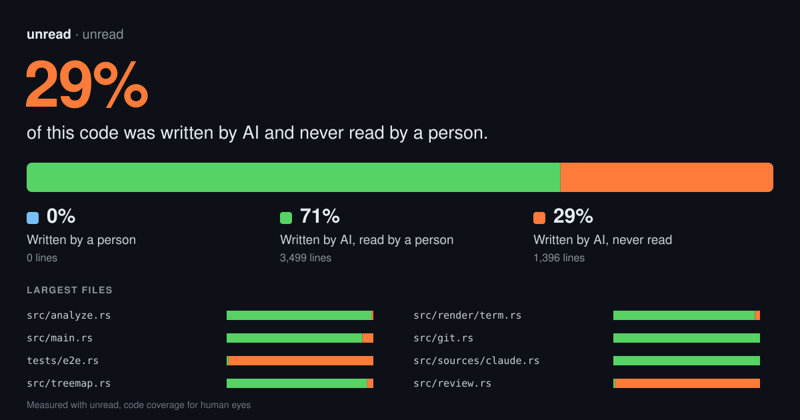

# unread

**Code coverage for human eyes.**


`unread` measures how much of a repository was written by AI and never read by a person.



That card is this repository, made with `unread card`. Every line falls into one of three groups:

- **Blue, written by a person.** Here, none: an agent wrote all of this repository.
- **Green, written by AI and read by a person.** The part its author has read so far.
- **Orange, written by AI and never read.** The rest. Read it and it turns green; change a line and it turns orange again.

```console
$ unread

  unread · unread

  28.5% unread
  ████████████████████████████████████░░░░░░░░░░░░░░
  1,396 of 4,895 lines of code were written by an agent and never seen by a person.

  █ human          0    0.0%   a person wrote it
  █ seen       3,499   71.5%   an agent wrote it, a person saw it  (attested 3,499)
  ░ unread     1,396   28.5%   an agent wrote it, no sign anyone looked

  read first                                        unread
   1  src/review.rs                                    239
   2  tests/e2e.rs                                     406  4 commits in 90 days
   3  src/risk.rs                                      146
```

## Why

Test coverage tells you which lines your tests ran. Nothing tells you which lines a person has looked at.

That used to be fine, because the person who wrote a line had read it. Agents now write code faster than anyone reads it, `git blame` still shows your name on it, and every dashboard stays green. The gap has a name, comprehension debt, and until now the only way to size it was a spreadsheet.

`unread` gives it a number, a map, and a way to pay it down.

## Install

Prebuilt binaries are attached to [every release](https://github.com/tannerfaust/unread/releases/latest). On an Apple silicon Mac:

```bash
curl -L https://github.com/tannerfaust/unread/releases/latest/download/unread-aarch64-apple-darwin.tar.gz | tar xz
sudo mv unread /usr/local/bin/
```

For another platform, swap in its archive. Each one holds a single `unread` binary.

| Platform | Archive |
| --- | --- |
| macOS, Apple silicon | `unread-aarch64-apple-darwin.tar.gz` |
| macOS, Intel | `unread-x86_64-apple-darwin.tar.gz` |
| Linux, x86_64 | `unread-x86_64-unknown-linux-gnu.tar.gz` |
| Linux, arm64 | `unread-aarch64-unknown-linux-gnu.tar.gz` |
| Windows, x86_64 | `unread-x86_64-pc-windows-msvc.zip` |

Two things to know:

- On macOS, download with `curl` as shown. A browser download is quarantined, and macOS refuses to open an unsigned binary.
- The Linux binaries are linked against the glibc of a current Ubuntu. If one does not start on an older distribution, build from source.

To build from source you need Rust 1.82 or newer:

```bash
cargo install --git https://github.com/tannerfaust/unread
```

Then, in any repository:

```bash
unread
```

There is nothing to set up. Claude Code and Codex already keep a log of every edit they make; `unread` reads those logs and your git history. The first run reads all your logs once (about 15 seconds for 12 GB on a laptop) and caches what it finds. After that a run takes as long as `git blame` does.

## Three labels, each with evidence

| Label | Meaning |
| --- | --- |
| `human` | A person wrote it. More exactly: nothing says an agent did, or a person corrected a commit marker with `unread claim`. |
| `seen` | An agent wrote it and something shows a person looked. |
| `unread` | An agent wrote it and nothing shows that anyone looked. |

What counts as **an agent wrote it**, strongest first:

1. **A patch in the agent's session log.** The log shows the agent adding this line to this file.
2. **A shell command in the session log.** The agent typed this exact line in a command that writes files, such as `cat > file <<EOF`, in a session that worked on this repository.
3. **The repository ledger**, `.unread/ledger.jsonl`, written by `unread record`.
4. **A commit marker.** The commit that introduced the line carries a `Co-Authored-By` trailer for an agent or was made by an agent's bot account.

What counts as **a person saw it**:

- **approved**: the diff or command was shown in a permission prompt and a person accepted it
- **edited**: a person changed the agent's proposal before accepting it
- **reviewed**: the pull request was reviewed by someone other than its author (`--github`)
- **attested**: a person marked it read with `unread next` or `unread mark`

Auto-accept modes, allow rules, classifiers and hooks are not a person. An edit they let through is unread.

Run `unread blame FILE` to see the evidence for every line:

```console
$ unread blame src/lines.rs
    1 █ //! Line normalisation shared by every matcher.     claude-code · marked read with unread
    8 █ pub fn skeleton(line: &str) -> String {

$ unread blame src/review.rs
    1 ░ //! Paying the debt down: read unread code one piece at a time, most urgent first.   claude-code · repository ledger
```

### What the number does not claim

- **Unread is a lower bound.** A line with no evidence either way counts as human. `unread` never calls a line agent-written without a source it can show you.
- **Seen is not understood.** It means a person had the code in front of them. That is the most a tool can know, and it is still far more than most repositories can say.
- **Zero is not the goal.** Generated fixtures and throwaway scripts may never need a reader. The point is to choose what stays unread instead of finding out later. Put what you have decided not to count in `.unreadignore`.

## Paying it down

```bash
unread next
```

shows the riskiest unread code one piece at a time. Read it, press `r`, move on. Each mark is saved with your name and how long you took, and if you mark 80 lines in two seconds it asks whether you are sure.

Marks are bound to the content of each line. When a line changes, it has to be read again.

Risk is simple and printed next to every file: unread lines, weighted up for paths that say auth, tokens, money, migrations and the like, weighted down for tests and styling, and scaled by how often the file has changed in the last 90 days.

## Commands

| Command | What it does |
| --- | --- |
| `unread` | Measure the repository and print the summary |
| `unread report` | Write a page with every file on a map, coloured by who wrote it, and open it |
| `unread card` | Write a 1200x630 picture like the one above, ready to post |
| `unread blame FILE` | Show a file line by line with the evidence behind each label |
| `unread next` | Read unread code, most urgent first, and mark what you read |
| `unread mark FILE[:A-B]` | Mark code as read without the walkthrough |
| `unread claim FILE[:A-B]` | Claim lines you wrote that a commit marker credits to an agent. Refused where a session log or the ledger shows the agent writing them |
| `unread check` | Fail when too much code is unread, for CI |
| `unread badge` | Print a README badge (`--json` for a shields.io endpoint) |
| `unread record` | Save what your logs know into `.unread/ledger.jsonl` |
| `unread hook install` | Run `unread record` on every commit |
| `unread sources` | Show where the evidence comes from |

Useful everywhere: `--path GLOB` to narrow the scope, `--base REV` to count only lines added since a revision, `--json` on `scan` for the full machine-readable report.

## Teams and CI

Session logs live on one person's machine. Two small files make the evidence travel with the code:

- `.unread/ledger.jsonl`: which lines an agent wrote
- `.unread/read.jsonl`: which lines a person marked read

Both hold hashes of lines, never code and never prompts. Both are append-only and merge without conflicts. Commit them.

```bash
unread hook install   # keeps the ledger current on every commit
```

Then gate what matters. This fails a pull request that adds unread code to the auth module:

```yaml
- uses: actions/checkout@v7
  with:
    fetch-depth: 0
- run: cargo install --git https://github.com/tannerfaust/unread
- run: unread check --no-logs --base origin/main --path 'src/auth/**' --max-lines 0
```

Or hold the whole repository to a ceiling with `unread check --max-unread 40`.

## Privacy

Everything runs on your machine. `unread` uploads nothing and has no telemetry.

- It reads session logs under `~/.claude` and `~/.codex` and keeps a cache of the edits it found in `~/.cache/unread`.
- `.unread/` in your repository holds hashes, names of people who marked code read, and timestamps.
- `--github` is the only feature that uses the network. It asks GitHub, through the `gh` CLI you are already signed in to, which commits arrived in a reviewed pull request. It sends commit hashes.

## Limits

- **Logs do not last forever.** Claude Code deletes session logs after 30 days by default. Lines older than your logs fall back to commit markers, and without a marker they count as human. `unread hook install` writes the evidence into the repository while it still exists.
- **Line-level evidence covers Claude Code and Codex.** Cursor, Copilot, Devin, Jules, Gemini CLI, opencode, Aider, Amp and Droid are recognised by their commit markers only.
- **Matching survives formatters, not rewrites.** Re-indenting, quote style, trailing commas and re-wrapping are handled. A line a person substantially rewrote is theirs.
- **Only tracked files count.** A new file appears once it is staged.
- **Prose, data and lockfiles are not counted** unless you pass `--include-docs`.

## Adding an agent

One file. A parser takes the bytes of a log and returns the edits in it:

```rust
pub fn parse(data: &[u8]) -> Vec<RawEdit>
```

See `src/sources/claude.rs` and `src/sources/codex.rs`, then register the directory in `src/sources/mod.rs`. Parsers know nothing about the repository being measured, so each one is small and testable on its own.

## Development

```bash
cargo test                                   # unit tests and end-to-end tests on real git repositories
cargo clippy --all-targets -- -D warnings
```

The end-to-end tests build a repository, write logs in the formats the agents write, run the real binary, and assert numbers that are counted by hand in the comments.

## License

MIT
